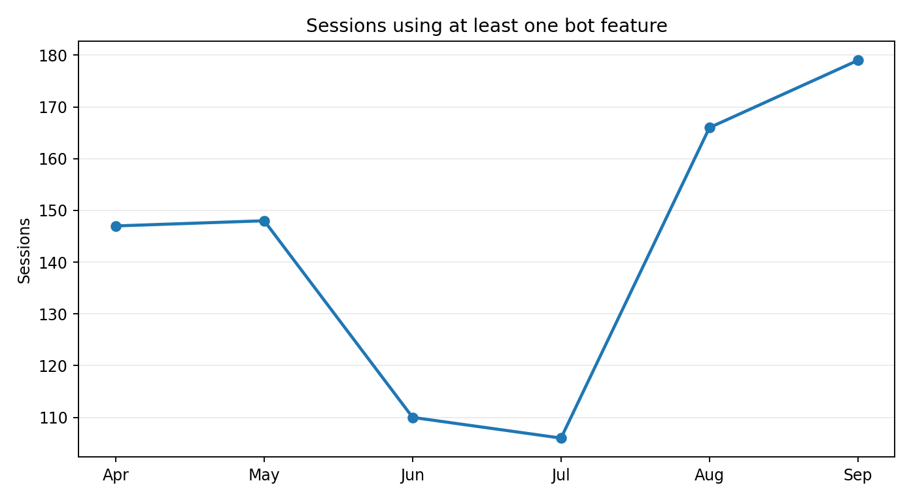
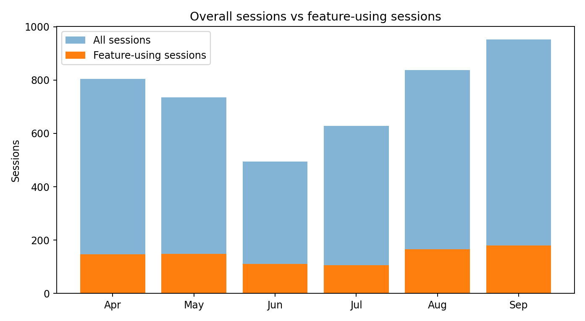

# Product Adoption and Usage — Evidence-Based Case Study

> **Data period:** 1 April–5 October 2026. **Evidence:** Aggregated analysis from an internal WhatsApp bot feature usage report, refreshed 5 October 2026. The underlying session-level dataset is confidential and is **not** included in this public repository. Figures are observational, not causal.

## What was measured

The analysis uses session logs to distinguish overall bot conversations from sessions containing at least one recognized feature action. It also tracks distinct phone numbers. **A phone number is not necessarily an individual user, and a feature tap is not proof of a successfully completed business transaction.**

## Usage at a glance

| Metric | Observed result |
|---|---:|
| Total bot sessions | **4,541** |
| Distinct phone numbers observed | **2,478** |
| Sessions with at least one feature action | **876** |
| Share of all sessions using a feature | **19.3%** |
| Phone numbers first observed using a feature during this reporting window | **520** |

## Monthly trend

| Month | All sessions | Feature-using sessions | Feature adoption within sessions |
|---|---:|---:|---:|
| Apr 2026 | 804 | 147 | 18.3% |
| May 2026 | 735 | 148 | 20.1% |
| Jun 2026 | 495 | 110 | 22.2% |
| Jul 2026 | 628 | 106 | 16.9% |
| Aug 2026 | 838 | 166 | 19.8% |
| Sep 2026 | 953 | 179 | 18.8% |
| Oct 1–5, 2026 (partial) | 88 | 20 | 22.7% |

Feature-using sessions increased from **106 in July** to **179 in September**, an increase of **68.9%**. Overall bot sessions grew from 628 to 953 over the same interval. The proportion of sessions with feature activity remained broadly stable; this is **volume growth**, not established improvement in the conversion rate to feature use.

## Most-used features

| Feature | Sessions with that feature |
|---|---:|
| Price List | 421 |
| Outstanding / Ledger | 271 |
| RFQ / Request Quote | 163 |
| Invoice Download | 76 |
| Brochure | 65 |
| Contact Support / Account Manager | 43 |
| Branch Information | 39 |
| Complaint Registration | 18 |
| Debit / Credit Note Download | 15 |

These counts overlap: a session can invoke several features. Counts represent **sessions engaging with a feature**, not successful fulfillment of a request.

## Product insights

**1. Commercial self-service shows observable demand.** Price lists and outstanding statements were among the strongest interactions. This supports prioritizing easily accessible commercial-document journeys.

**2. More traffic is not automatically more adoption.** April–May feature use was 295 / 1,539 sessions (19.2%); August–September was 345 / 1,791 (19.3%). The similar proportions suggest a need to improve discovery of available features, not just expand reach.

**3. Evaluate proactive promotion separately.** Broadcast-driven reply spikes can increase session volume without creating equivalent meaningful feature use. A measurement framework should distinguish campaign replies, automated business responses and customer-initiated activity.

**4. Instrumentation reliability affects product decisions.** The source report flagged an ERP customer-lookup classification error across all 147 sessions from 29 September onward in the reporting window. This makes the new-versus-existing customer split unreliable during this period. The evidence does not by itself establish whether the customer-facing lookup failed or only its analytics logging did.

## Product-owner actions this analysis informs

- Prioritize improving the most-used commercial self-service flows.
- Increase the discoverability of useful bot features in customer communications.
- Track **feature completion**, not only menu taps.
- Segment promotional inbound traffic from customer-initiated journeys.
- Investigate lookup and event-classification errors before drawing conclusions from customer segments.
- Measure usage before and after interventions using comparable time windows and explicit campaign dates.

These are **analysis-derived recommendations**; they should not be interpreted as evidence that all actions were implemented.

## What this does *not* establish

- The number of unique human customers or verified activated accounts.
- Successful deliveries of every requested document or every RFQ.
- A causal lift attributable to any specific marketing campaign.
- Time saved, cost savings, orders closed or revenue generated.
- Proof that proposed AI-based next-generation capabilities were deployed.

## Evidence and confidentiality

The aggregate metrics were obtained from an internal report built on production session data. This case study intentionally excludes phone numbers, party codes, customer names, chat transcripts and raw session records. Obtain appropriate authorization before publishing even aggregated internal analytics. The chart and table values are rounded to one decimal place where applicable.
