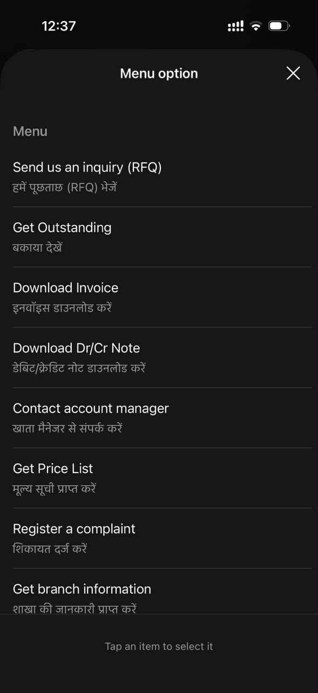
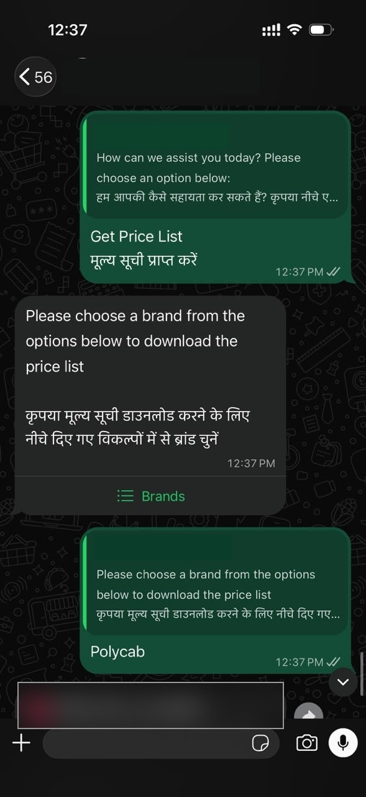
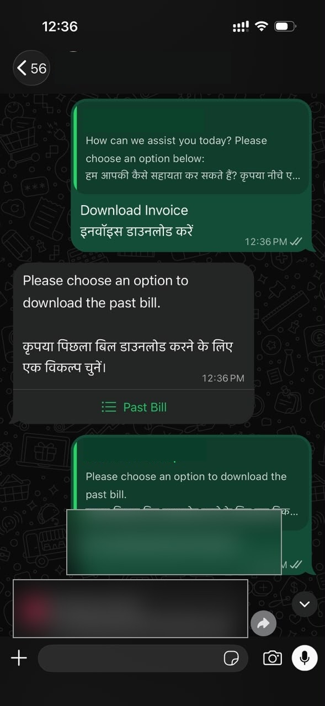
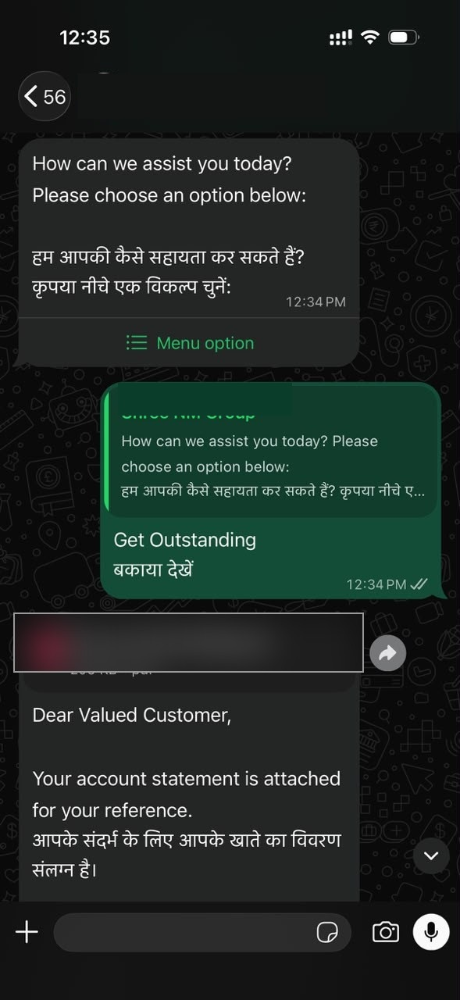
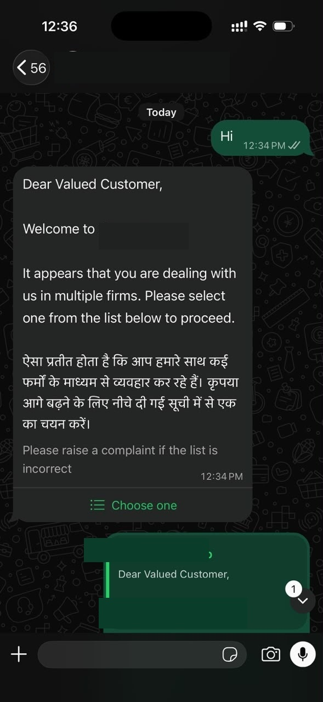

# Product Walkthrough — Volty 1.0

## Evidence status

These screenshots were captured from the WhatsApp interface of Volty, a B2B customer self-service assistant. They demonstrate visible user-interface behavior in individual sessions, not production-wide adoption, uptime, authorization compliance, or proof that every documented feature has been delivered. Identifying document references have been obscured.

**My role:** End-to-end product ownership across ideation, requirements, delivery coordination, launch, promotion, and adoption initiatives (self-reported; supporting launch and performance records will be added separately).

## 1. Bilingual service menu

**What is visible:** A list-based WhatsApp service menu with English and Hindi descriptions for inquiries (RFQs), outstanding statements, invoices, debit/credit notes, account manager contact, price lists, complaints, and branch information.

**Product significance:** Groups recurring B2B service needs into a customer-accessible channel. Bilingual labeling supports users who prefer Hindi descriptions.

## 2. Brand-based price-list delivery

**What is visible:** A customer selects the price-list flow, is prompted to choose a brand, and receives a document attachment.

**Product significance:** A guided self-service sequence connects a customer request to a relevant commercial document without needing the user to compose a free-text request.

## 3. Invoice download journey

**What is visible:** The customer chooses invoice download, sees a past-bill selection step, and receives a PDF attachment. Document identifiers have been obscured.

**Product significance:** Makes a frequently requested post-sale document accessible through WhatsApp. The screenshot supports a completed *demonstrated journey*, not a measured success rate.

## 4. Outstanding statement retrieval

**What is visible:** Selecting Get Outstanding produces a PDF attachment with a bilingual explanatory message. The document reference has been obscured.

**Product significance:** Provides a convenient entry point for an account-related self-service workflow. The screenshot alone does not establish the underlying authorization checks or ERP source.

## 5. Multiple-firm customer selection

**What is visible:** The bot recognizes that a contact may deal with multiple firms and asks the user to select the appropriate firm before proceeding. The message also offers a complaint route if the list is incorrect.

**Product significance:** A notable B2B edge case: a phone number may correspond to more than one commercial account. Requiring selection helps establish account context before subsequent actions. This screenshot does not independently prove secure account authorization.

## What these screenshots establish — and what they do not

| Supported by screenshots | Requires additional evidence |
|---|---|
| Interactive bilingual menu | Adoption or monthly active user counts |
| Brand-based price-list request with attachment | Quantified support time savings |
| Invoice request with document attachment | Live usage across the wider customer base |
| Outstanding-statement request with attachment | ERP reconciliation and access-control testing |
| Multi-firm selection prompt | UAT sign-off, release milestones and post-launch performance |

## Next supporting artifacts

- A release timeline supported by dated project records
- UAT evidence for critical cases and exceptions
- Sanitized usage analytics with defined measurement periods
- Launch and adoption campaign evidence
- Product-owner decisions and tradeoffs linked to artifacts

> **Confidentiality:** Screenshots are shared as portfolio evidence only with appropriate organizational authorization. No customer statement, invoice content, customer identity or internal credentials should be published.
